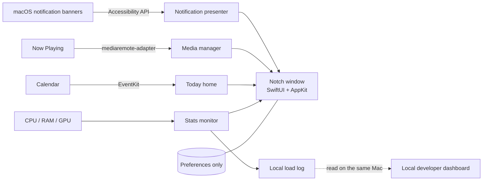

# Notch Companion for macOS: Case Study

> A privacy-first app that turns the MacBook notch into a quiet control center for one developer's day: notifications, system load, calendar and shortcuts, with nothing leaving the Mac.
> **Source code is private.** This repository documents the project; a live walkthrough is available on request.

## The problem

Open source notch apps for macOS do a lot, and that is the problem. The one I started from shipped with camera, microphone and screen recording permissions, could send song titles to third-party servers when lyrics lookup was turned on, rewrote the macOS wallpaper store and even carried a monitor that restarts the app when it passes 1 GB of memory. I wanted the opposite: only what I use every day, no network, the fewest permissions possible and a footprint I could measure on every change.

## Built on open source

This project is a private fork, not a from-scratch app. Credit where it is due:

| Project | What it gives this app | License |
|---|---|---|
| [Atoll](https://github.com/Ebullioscopic/Atoll) by Ebullioscopic | The base app: notch window, live activities, media, calendar, HUDs | GPL-3.0 |
| [boring.notch](https://github.com/TheBoredTeam/boring.notch) by TheBoredTeam | The project Atoll itself is derived from | GPL-3.0 |
| [mediaremote-adapter](https://github.com/ungive/mediaremote-adapter) by Jonas van den Berg | Now Playing information on recent macOS versions | BSD-3-Clause |
| [Defaults](https://github.com/sindresorhus/Defaults), [KeyboardShortcuts](https://github.com/sindresorhus/KeyboardShortcuts), [LaunchAtLogin-Modern](https://github.com/sindresorhus/LaunchAtLogin-Modern) by Sindre Sorhus | Typed preferences, global shortcuts, launch at login | MIT |
| [Lottie](https://github.com/airbnb/lottie-spm) by Airbnb and [LottieUI](https://github.com/jasudev/LottieUI) | Animations | Apache-2.0 and MIT |
| [MacroVisionKit](https://github.com/TheBoredTeam/MacroVisionKit), [SkyLightWindow](https://github.com/Lakr233/SkyLightWindow), [SwiftUI-Introspect](https://github.com/siteline/swiftui-introspect), [swift-syntax](https://github.com/swiftlang/swift-syntax) | Full screen detection, window layering, SwiftUI access to AppKit, macros | MIT and Apache-2.0 |

The fork keeps the GPL-3.0 license and the upstream NOTICE. It is for personal use and is not distributed.

## What I built

- **Audit before code**: a full review of the upstream app (permissions, network calls, files written to disk, idle cost) that ranked every finding and decided what to cut.
- **A diet**: removed the clipboard manager, color picker, screen assistant, camera mirror, weather, lock screen artwork, lyrics lookup, online artwork and an LLM usage panel that read local AI credentials. About 54k lines of Swift came out.
- **Notifications in the notch**: system banners are mirrored into the notch through the Accessibility API; a click opens the source app. Quiet mode for one hour or per app, grouping of bursts ("+N"), three layouts and colored states for alerts from my local developer dashboard.
- **System load at a glance**: CPU and RAM on the "wings" of the closed notch, alerts for CPU, RAM and GPU, and a one line per minute local load log that feeds my dashboard.
- **Today home screen**: calendar, system monitor and quick actions in one view.
- **Dev tab**: configurable shortcut buttons (URL, app or macOS Shortcut) and a one-click screen recording button that uses the system tool, so the app needs no new permission.
- **Profiles**: Work, Meeting, Focus and Presentation switch several settings at once.
- **Menu bar menu**: live numbers in the icon, keep the Mac awake, mute notifications.
- **Settings**: a Home tab, export, import and reset, and a full Brazilian Portuguese localization.

## Architecture

- **House rules checked on every pull request**: no network access, no permission beyond Accessibility and Calendar (Downloads only behind its toggle), nothing written to disk beyond preferences except one declared local log, and every feature behind a toggle that keeps its module unloaded when off.
- **Measured, not guessed**: memory is measured as physical footprint before and after each change, with a control build in the same window. At rest the app sits at about 43 MB and under 1% CPU.
- **Offline probes**: 20 small command line probes read the source and the built app and fail when a rule breaks (for example, a settings tab without its form, or a debug entitlement left in a release build). They run on every pull request.
- **Lean code rule**: SwiftLint runs only on the files a change touches, with a baseline for legacy warnings, so new code stays small without a forced rewrite of upstream code.
- **Upstream friendly**: `main` is the upstream branch plus the fork commits on top, rebased on each upstream release.

## Scale

- ~62k lines of Swift in 265 files (upstream included)
- About 15k lines of Swift added and 54k removed compared with the upstream base
- 520+ commits and 64 merged pull requests on the fork
- 20 offline probe tools

## My role

Product owner and lead of the whole fork: I ran the audit, wrote the plan and the house rules, made every product decision and approved every release to my own machine. The code was written by AI coding agents (Claude Code) working under my direction, each change checked by a separate reviewer agent and by the probes before I approved it. The upstream code belongs to the Atoll and boring.notch authors.

---
Built by **Victor Sestrem** · [LinkedIn](https://www.linkedin.com/in/victor-sestrem/) · victor-sestrem@hotmail.com
